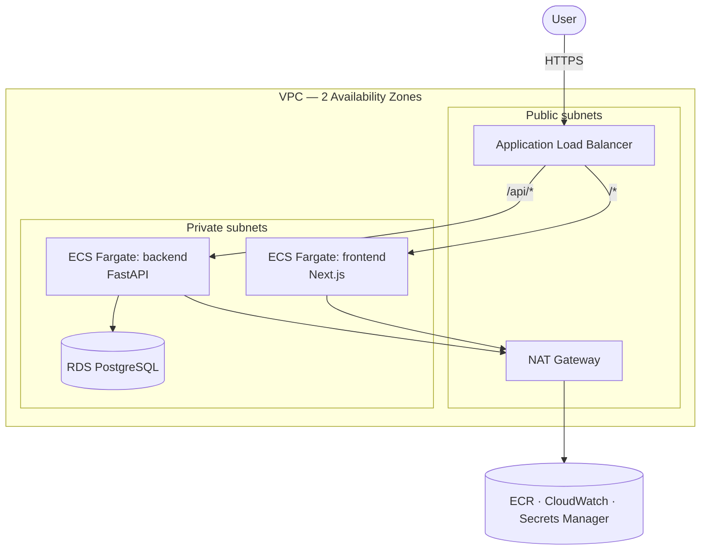

# TaskFlow — Production AWS DevOps Platform

**FastAPI + Next.js + PostgreSQL, deployed to AWS ECS Fargate with Terraform and GitHub Actions.**

This repository is a complete, production-style DevOps project:

- **Infrastructure as Code**: Terraform builds the VPC, load balancer, containers, database, IAM, DNS/TLS and monitoring. Nothing is created by clicking in the console.
- **Containers**: multi-stage, non-root Docker images, scanned for vulnerabilities on every build.
- **CI/CD**: every pull request is linted, tested and planned. Every merge deploys to staging automatically, and to production after a manual approval. Deploys are zero-downtime and roll back automatically if they fail.
- **Security**: private subnets, layered security groups, secrets in AWS Secrets Manager, encrypted storage, and GitHub→AWS access through OIDC (no stored access keys).
- **Observability**: structured JSON logs, CloudWatch dashboard, alarms → email.
- **Team workflow**: trunk-based development, PR reviews, branch protection, staging and production environments ([CONTRIBUTING.md](CONTRIBUTING.md)).

The app itself is a small Kanban task board. It's deliberately simple so the project stays focused on the platform around it.

---

## Table of contents

1. [Architecture](#1-architecture)
2. [Tech stack](#2-tech-stack)
3. [Repository layout](#3-repository-layout)
4. [Cost warning — read first](#4-cost-warning--read-first)
5. [Step-by-step guide](#5-step-by-step-guide)
   - [Phase 0 — Prerequisites](#phase-0--prerequisites)
   - [Phase 1 — Run everything locally](#phase-1--run-everything-locally)
   - [Phase 2 — Put the code on GitHub](#phase-2--put-the-code-on-github)
   - [Phase 3 — Bootstrap AWS (state bucket, ECR, OIDC roles)](#phase-3--bootstrap-aws-state-bucket-ecr-oidc-roles)
   - [Phase 4 — Push the first container images](#phase-4--push-the-first-container-images)
   - [Phase 5 — Configure GitHub (variables, environments, branch protection)](#phase-5--configure-github-variables-environments-branch-protection)
   - [Phase 6 — Create the staging environment](#phase-6--create-the-staging-environment)
   - [Phase 7 — Your first CI/CD deployment](#phase-7--your-first-cicd-deployment)
   - [Phase 8 — Create production and promote a release](#phase-8--create-production-and-promote-a-release)
   - [Phase 9 — Custom domain + HTTPS (optional)](#phase-9--custom-domain--https-optional)
   - [Phase 10 — Monitoring, logs and debugging](#phase-10--monitoring-logs-and-debugging)
   - [Phase 11 — Day-2 operations (rollback, scaling, migrations)](#phase-11--day-2-operations)
   - [Phase 12 — Tear everything down](#phase-12--tear-everything-down)
6. [How the CI/CD pipeline works](#6-how-the-cicd-pipeline-works)
7. [Security practices](#7-security-practices)
8. [Troubleshooting](#8-troubleshooting)
9. [What to put on your resume](#9-what-to-put-on-your-resume)
10. [Ideas to extend it](#10-ideas-to-extend-it)

---

## 1. Architecture



**How a request flows:**

1. The browser calls `https://your-domain/`, which goes to the **ALB**, which forwards it to a **frontend** task.
2. The page calls `/api/tasks`, which the ALB routes (path rule `/api/*`) to a **backend** task.
3. The backend reads/writes **RDS** over port 5432. Its credentials were injected from **Secrets Manager** when the container started.
4. Containers send logs to **CloudWatch**. Alarms email you through **SNS** when something breaks.

The containers and the database have **no public IP addresses**. The ALB is the only thing reachable from the internet.

More diagrams and the reasoning behind each design decision are in [docs/architecture.md](docs/architecture.md).

---

## 2. Tech stack

| Layer | Technology |
|---|---|
| Backend | Python 3.12, FastAPI, SQLAlchemy 2, Alembic, Gunicorn + Uvicorn |
| Frontend | Next.js 15 (App Router, standalone output), React 19, TypeScript |
| Database | PostgreSQL 16 (Docker locally, Amazon RDS in AWS) |
| Containers | Docker multi-stage builds, Docker Compose, Amazon ECR |
| Compute | Amazon ECS on Fargate (Spot in staging), Application Auto Scaling |
| Networking | VPC, public/private subnets, NAT Gateway, ALB, Route 53, ACM |
| Security | IAM least privilege, GitHub OIDC, Secrets Manager, security groups, Trivy, Checkov |
| IaC | Terraform ≥ 1.10, S3 remote state with native locking, reusable modules |
| CI/CD | GitHub Actions, GitHub Environments with approvals, Dependabot |
| Observability | CloudWatch Logs (JSON), Container Insights, alarms, dashboard, SNS |

---

## 3. Repository layout

```
aws-devops-platform/
├── backend/                     FastAPI service
│   ├── app/                     main.py, config, db, models, routers/
│   ├── alembic/                 database migrations
│   ├── tests/                   pytest
│   └── Dockerfile               multi-stage, non-root
├── frontend/                    Next.js app
│   ├── app/                     page.tsx (task board), layout.tsx
│   └── Dockerfile               multi-stage, standalone output
├── proxy/nginx.conf             local stand-in for the ALB
├── docker-compose.yml           full local stack
├── infra/
│   ├── bootstrap/               ONE-TIME stack: state bucket, ECR, GitHub OIDC roles
│   └── terraform/               per-environment stack (staging / prod)
│       ├── main.tf              wires the modules together
│       ├── security.tf          security groups
│       ├── envs/                *.tfvars and *.backend.hcl per environment
│       └── modules/
│           ├── network/         VPC, subnets, NAT, route tables, flow logs
│           ├── rds/             PostgreSQL + Secrets Manager credentials
│           ├── alb/             load balancer, target groups, TLS, DNS
│           ├── ecs/             cluster, task definitions, services, autoscaling
│           └── monitoring/      alarms, SNS, dashboard
├── scripts/
│   ├── deploy.sh                migrate → roll out → verify (used by CI)
│   └── push-initial-images.sh   one-time first image push
├── .github/workflows/
│   ├── ci.yml                   PR checks
│   ├── terraform.yml            infra plan (PR) / apply (main)
│   ├── deploy.yml               build once → staging → approval → prod
│   └── _deploy-env.yml          reusable deploy + smoke test
├── docs/architecture.md
├── CONTRIBUTING.md              team workflow
└── Makefile                     shortcuts
```

---

## 4. Cost warning — read first

This builds real AWS infrastructure that **costs money every hour it runs**, even when nobody uses the app.
Rough monthly figures for `us-west-2` (check the [AWS Pricing Calculator](https://calculator.aws/) for current prices):

| Component | Staging | Production |
|---|---|---|
| NAT Gateway(s) | 1 (~$35–45) | 2 (~$70–90) |
| Application Load Balancer | ~$20 | ~$20+ |
| RDS PostgreSQL | t4g.micro single-AZ (~$15) | t4g.small Multi-AZ (~$50+) |
| ECS Fargate | 2 small Spot tasks (~$5–10) | 4+ tasks (~$40+) |
| CloudWatch, Secrets Manager, ECR | a few dollars | a few dollars |
| **Total (approx.)** | **~$75–90 / month** | **~$200+ / month** |

**To keep the bill small:**

- Set up a **billing budget alert** first (Phase 0, step 4).
- Only create **staging** while you're learning. Production is optional.
- When you're done for the day or week, run **`make destroy ENV=staging`** (Phase 12). You can rebuild everything in about 15 minutes with `make apply`. That's what Infrastructure as Code is for.

---

## 5. Step-by-step guide

Commands assume **macOS/Linux or WSL2 on Windows**. `$` lines are commands to type.

### Phase 0 — Prerequisites

**0.1 Install the tools**

| Tool | Check it works | Install |
|---|---|---|
| Git | `git --version` | https://git-scm.com |
| Docker Desktop | `docker compose version` | https://docs.docker.com/get-docker/ |
| AWS CLI v2 | `aws --version` | https://docs.aws.amazon.com/cli/latest/userguide/getting-started-install.html |
| Terraform ≥ 1.10 | `terraform version` | https://developer.hashicorp.com/terraform/install |
| GitHub CLI (optional) | `gh --version` | https://cli.github.com |
| Session Manager plugin (for ECS Exec) | `session-manager-plugin` | https://docs.aws.amazon.com/systems-manager/latest/userguide/session-manager-working-with-install-plugin.html |
| Python 3.12 + Node 22 (optional, for running without Docker) | | |

**0.2 Create a safe admin identity (never use the root account)**

1. Sign in to the AWS console as root → enable **MFA** on root → sign out of root.
2. Recommended: **IAM Identity Center** → create a user with the `AdministratorAccess` permission set → configure the CLI:
   ```bash
   $ aws configure sso            # follow the prompts, name the profile "taskflow"
   $ export AWS_PROFILE=taskflow
   ```
   Simpler alternative: create an IAM user with `AdministratorAccess` and MFA, create an access key, then run `aws configure`.
3. Verify:
   ```bash
   $ aws sts get-caller-identity
   ```
   You should see your 12-digit **Account ID**. Write it down; it's used below as `<ACCOUNT_ID>`.

**0.3 Choose a region.** This project defaults to `us-west-2` (Oregon). To use another region, change `aws_region` in `infra/bootstrap/terraform.tfvars`, `infra/terraform/envs/*.tfvars` and `envs/*.backend.hcl`.

**0.4 Create a budget alert** (takes 2 minutes and protects you from surprise bills):
Console → **Billing and Cost Management → Budgets → Create budget → Monthly cost budget**, e.g. $50, with an email alert at 80%.

---

### Phase 1 — Run everything locally

Make sure it all works on your laptop before touching AWS.

```bash
$ cd aws-devops-platform
$ docker compose up --build
```

This starts the same layout as production:

| Container | Plays the role of |
|---|---|
| `db` | RDS |
| `migrate` | the one-off ECS migration task (runs `alembic upgrade head`, then exits) |
| `backend`, `frontend` | the two ECS services |
| `proxy` (nginx) | the ALB: `/api/*` → backend, everything else → frontend |

Open **http://localhost:8080** and add a few tasks. Then check:

```bash
$ curl localhost:8080/api/health          # {"status":"ok","environment":"local",...}
$ curl localhost:8080/api/health/ready    # {"status":"ready"} → DB reachable
$ open http://localhost:8080/api/docs     # interactive API docs (Swagger)
```

Run the tests and linters:

```bash
$ cd backend && python -m venv .venv && source .venv/bin/activate
$ pip install -r requirements-dev.txt
$ pytest -q && ruff check .
$ cd ..
```

Stop the stack with `docker compose down` (add `-v` to also delete the local database).

> **Why mirror production locally?** Many "works on my machine" bugs come from routing, ports or env vars being different between environments. With the nginx proxy and the migration step, local behaves the same way AWS does.

---

### Phase 2 — Put the code on GitHub

1. Create an **empty** repository on GitHub named `aws-devops-platform`. Use **Public** if you want free environment approvals (see 5.2) and want recruiters to see it.
2. Push:
   ```bash
   $ git init -b main
   $ git add .
   $ git commit -m "chore: initial commit"
   $ git remote add origin git@github.com:<your-github-username>/aws-devops-platform.git
   $ git push -u origin main
   ```
   The **CI** workflow runs straight away; check the **Actions** tab. The Terraform and Deploy workflows will fail until Phases 3–5 are done. That's expected.

---

### Phase 3 — Bootstrap AWS (state bucket, ECR, OIDC roles)

Some things must exist **before** Terraform and CI/CD can work:

| Resource | Why |
|---|---|
| **S3 state bucket** | Terraform records what it built in a "state file". Keeping it in S3 (versioned, encrypted) means everyone on the team, and CI, shares the same state. Native S3 locking stops two `apply`s from running at once. |
| **ECR repositories** | Private Docker registries for `backend` and `frontend`. Images are tagged with the git commit SHA and the tags are **immutable**. |
| **GitHub OIDC provider + 3 IAM roles** | GitHub Actions swaps a short-lived token for temporary AWS credentials, so no AWS keys are stored in GitHub. Each role trusts **only your repo**, and only in specific situations (see below). |

The three roles:

| Role | Used by | Trusted from | Permissions |
|---|---|---|---|
| `taskflow-gha-terraform-plan` | `terraform plan` on PRs | pull requests, `main` | read-only |
| `taskflow-gha-terraform-apply` | `terraform apply` | GitHub environments `staging`/`production` only | admin |
| `taskflow-gha-deploy` | app deploys | `main` + those environments | push to ECR, update ECS, nothing else |

**Run it:**

```bash
$ cd infra/bootstrap
$ cp terraform.tfvars.example terraform.tfvars
$ nano terraform.tfvars          # set github_owner and github_repo
$ terraform init
$ terraform plan                 # read it! ~15 resources to add
$ terraform apply                # type "yes"
$ terraform output
```

Write down the outputs: `state_bucket`, `ecr_registry` and the three `github_role_arns`.

**Point the environment stack at the state bucket.** Edit both files and replace `<ACCOUNT_ID>`:

```bash
$ cd ../terraform
$ sed -i.bak "s/<ACCOUNT_ID>/$(aws sts get-caller-identity --query Account --output text)/" envs/staging.backend.hcl envs/prod.backend.hcl && rm envs/*.bak
$ cat envs/staging.backend.hcl
```

**Protect the bootstrap state.** The bootstrap stack keeps its own state in a local file, `infra/bootstrap/terraform.tfstate`. It's git-ignored on purpose. Back it up somewhere safe, or move it into the bucket:

```hcl
# add to infra/bootstrap/main.tf inside the terraform { } block
backend "s3" {
  bucket       = "taskflow-tfstate-<ACCOUNT_ID>"
  key          = "bootstrap/terraform.tfstate"
  region       = "us-west-2"
  encrypt      = true
  use_lockfile = true
}
```
then run `terraform init -migrate-state` and answer `yes`.

---

### Phase 4 — Push the first container images

The ECS services need an image to start from, but CI/CD can't deploy until the cluster exists. To break that chicken-and-egg problem, push one image pair tagged `initial` by hand:

```bash
$ cd ../..                         # repo root
$ AWS_REGION=us-west-2 ./scripts/push-initial-images.sh
```

Check them in the console under **ECR → Repositories → taskflow/backend**, or with:

```bash
$ aws ecr describe-images --repository-name taskflow/backend --query 'imageDetails[].imageTags'
```

> On an Apple Silicon Mac the script builds with `--platform linux/amd64`, because Fargate in this setup runs x86_64.

---

### Phase 5 — Configure GitHub (variables, environments, branch protection)

**5.1 Repository variables.** Go to **Settings → Secrets and variables → Actions → Variables tab → New repository variable**. These are not secrets: they're role ARNs and names, and the trust policy is what protects them.

| Name | Value |
|---|---|
| `AWS_REGION` | `us-west-2` |
| `PROJECT` | `taskflow` |
| `ECR_REGISTRY` | bootstrap output `ecr_registry`, e.g. `123456789012.dkr.ecr.us-west-2.amazonaws.com` |
| `AWS_TF_PLAN_ROLE_ARN` | bootstrap output |
| `AWS_TF_APPLY_ROLE_ARN` | bootstrap output |
| `AWS_DEPLOY_ROLE_ARN` | bootstrap output |

Or with the GitHub CLI:

```bash
$ gh variable set AWS_REGION   --body us-west-2
$ gh variable set PROJECT      --body taskflow
$ gh variable set ECR_REGISTRY --body "$(terraform -chdir=infra/bootstrap output -raw ecr_registry)"
$ terraform -chdir=infra/bootstrap output -json github_role_arns \
    | jq -r 'to_entries[] | "\(.key) \(.value)"' \
    | while read k v; do gh variable set "$k" --body "$v"; done
```

**5.2 Environments.** Go to **Settings → Environments** and create two:

| Environment | Settings |
|---|---|
| `staging` | Deployment branches: **Selected branches → `main`** |
| `production` | Deployment branches: **`main`** · **Required reviewers**: yourself or teammates · optionally a wait timer |

The `production` environment is the **manual approval gate**. Pipelines pause there until a reviewer clicks *Approve*. (Required reviewers are free on public repos. Private repos need GitHub Pro/Team.)

Optional, after Phase 9: add an environment variable `APP_URL` (e.g. `https://staging.example.com`) to each environment so the smoke tests use your domain.

**5.3 Branch protection.** Go to **Settings → Branches (or Rules) → Add rule for `main`**:

- ✅ Require a pull request before merging (1 approval)
- ✅ Require status checks to pass: select the CI jobs (`Backend — lint, test, migrations`, `Frontend — typecheck & build`, `Docker build…`, `Terraform — fmt, validate…`)
- ✅ Require branches to be up to date
- ✅ Do not allow bypassing the above settings

From now on, `main` only changes through reviewed, tested pull requests.

---

### Phase 6 — Create the staging environment

Do the first `apply` from your laptop so you can watch it. After this, the pipeline handles infrastructure changes.

```bash
$ make init  ENV=staging     # terraform init with the staging state file
$ make plan  ENV=staging     # shows ~60 resources to create. Read it!
$ make apply ENV=staging     # 10–15 min (RDS and NAT are the slow ones)
```

Then commit the provider lock file Terraform just created, so everyone uses the same provider versions:

```bash
$ git checkout -b infra/lock-file
$ git add infra/terraform/.terraform.lock.hcl infra/terraform/envs/*.backend.hcl
$ git commit -m "infra: add provider lock file and state config"
$ git push -u origin infra/lock-file      # open a PR and merge it
```

**What was created** (look at each one in the console and compare it with the code; it's the best way to learn):

| Console page | Resource | Code |
|---|---|---|
| VPC | VPC, 4 subnets, IGW, NAT, route tables, S3 endpoint, flow logs | `modules/network` |
| EC2 → Security Groups | `alb`, `app`, `db` SGs | `security.tf` |
| RDS | `taskflow-staging` PostgreSQL 16 | `modules/rds` |
| Secrets Manager | `taskflow-staging-db-credentials` | `modules/rds` |
| EC2 → Load Balancers | `taskflow-staging` ALB + 2 target groups | `modules/alb` |
| ECS → Clusters | `taskflow-staging` with `backend` + `frontend` services | `modules/ecs` |
| CloudWatch | log groups, alarms, dashboard | `modules/ecs`, `modules/monitoring` |

**Open the app:**

```bash
$ terraform -chdir=infra/terraform output app_url
```

Open that URL. It's `http://taskflow-staging-xxxx.us-west-2.elb.amazonaws.com`. Wait 1–2 minutes for the targets to turn healthy.

You'll see "API unreachable", or a 500 on `/api/tasks`: **the database tables don't exist yet**. That's expected. Terraform builds infrastructure, it doesn't run migrations. The deploy pipeline in the next phase runs them. To fix it right now by hand:

```bash
$ PROJECT=taskflow ENVIRONMENT=staging IMAGE_TAG=initial \
  ECR_REGISTRY=<ACCOUNT_ID>.dkr.ecr.us-west-2.amazonaws.com ./scripts/deploy.sh
```

(`deploy.sh` needs `jq` installed.)

---

### Phase 7 — Your first CI/CD deployment

Now let the pipeline do the work. Make a visible change on a branch:

```bash
$ git checkout main && git pull
$ git checkout -b feat/page-subtitle
# edit frontend/app/page.tsx, e.g. change <h1>TaskFlow</h1> to <h1>TaskFlow 🚀</h1>
$ git commit -am "feat(frontend): new title"
$ git push -u origin feat/page-subtitle
$ gh pr create --fill     # or open the PR in the browser
```

**On the pull request** (`ci.yml`) you'll see:
1. Backend: ruff lint → pytest → Alembic migrations applied to a real Postgres container (upgrade → downgrade → upgrade).
2. Frontend: TypeScript check → production build.
3. Docker: both images built and scanned by **Trivy**. Fixable CRITICAL/HIGH CVEs fail the build.
4. Terraform: `fmt`, `validate`, plus a **Checkov** security scan.

**Merge the PR.** `deploy.yml` then:
1. **Builds** both images once, tags them with the commit SHA and pushes them to ECR.
2. **Staging**: `scripts/deploy.sh` registers new task definitions → runs `alembic upgrade head` as a one-off Fargate task (stops if it fails) → rolls both services → waits until stable → checks ECS didn't roll back.
3. **Smoke test**: calls `/api/health/ready` and checks that `/api/health` reports exactly the new commit SHA.
4. **Production** waits for approval (Phase 8).

Reload the staging URL. The version badge on the page shows the new commit SHA.

> **Zero downtime:** ECS starts the new tasks first (`maximum_percent = 200`). The ALB only sends them traffic once their health checks pass, and only then are the old tasks drained and stopped (`minimum_healthy_percent = 100`).

---

### Phase 8 — Create production and promote a release

```bash
$ make init  ENV=prod
$ make plan  ENV=prod
$ make apply ENV=prod
```

Production differs from staging only through `envs/prod.tfvars`. The same modules run with:
- **one NAT Gateway per AZ** (one AZ failing doesn't cut off the other),
- **Multi-AZ RDS** with automatic failover, and **deletion protection** + a final snapshot,
- **on-demand** Fargate (no Spot interruptions), and at least 2 tasks per service,
- longer log retention.

**Promote a release:** open **Actions → Deploy → the latest run**. The `production` job shows *Waiting for review*. Click **Review deployments → Approve**. The **same images** that passed staging are now deployed to production.

**Infrastructure changes** work the same way. A PR that touches `infra/terraform/**` gets a `terraform plan` comment for both environments. Merging it applies staging automatically, then prod after approval (`terraform.yml`).

---

### Phase 9 — Custom domain + HTTPS (optional)

You need a domain with a **Route 53 public hosted zone**: either buy the domain in Route 53, or create a hosted zone and point your registrar's nameservers at it.

1. Edit `infra/terraform/envs/staging.tfvars`:
   ```hcl
   domain_name       = "staging.example.com"
   route53_zone_name = "example.com"
   ```
2. Open a PR, check the plan, and merge. Terraform will:
   - request a free **ACM** certificate and validate it automatically through DNS,
   - add an **HTTPS :443** listener with a TLS 1.3 policy, and make HTTP redirect to HTTPS,
   - create an **A (alias)** record → ALB.
3. Set the GitHub environment variable `APP_URL=https://staging.example.com` so smoke tests use HTTPS.

Do the same for prod (e.g. `app.example.com`).

---

### Phase 10 — Monitoring, logs and debugging

**Alerts:** set `alert_email` in the tfvars and apply. **Then click the confirmation link AWS emails you**, or you won't get any alerts. Alarms (`modules/monitoring`):

| Alarm | Fires when |
|---|---|
| `alb-target-5xx` | > 10 server errors per minute for 3 minutes |
| `alb-p95-latency` | 95th-percentile response time > 1s |
| `<svc>-unhealthy-targets` | any task failing ALB health checks |
| `<svc>-cpu-high` / `memory-high` | > 85% even after autoscaling |
| `rds-cpu-high`, `rds-free-storage-low` | database under pressure |

**Dashboard:** `terraform -chdir=infra/terraform output cloudwatch_dashboard` gives a direct link (requests, 5xx errors, latency, ECS CPU, RDS CPU and connections).

**Logs:** the backend writes one JSON object per request, so you can query it. Go to **CloudWatch → Logs Insights**, select `/ecs/taskflow-staging/backend`:

```
fields @timestamp, method, path, status, duration_ms
| filter status >= 500
| sort @timestamp desc
| limit 50
```

```
stats avg(duration_ms), pct(duration_ms, 95), count() by path
| sort count() desc
```

Follow logs live from the terminal:

```bash
$ aws logs tail /ecs/taskflow-staging/backend --follow
```

**Shell into a running container** (ECS Exec, like `docker exec`):

```bash
$ TASK=$(aws ecs list-tasks --cluster taskflow-staging --service-name backend --query 'taskArns[0]' --output text)
$ aws ecs execute-command --cluster taskflow-staging --task "$TASK" \
    --container backend --interactive --command "/bin/sh"
```

**Slow SQL:** RDS logs queries slower than 500 ms (`log_min_duration_statement`) to CloudWatch. **Performance Insights** on the RDS page shows the top SQL by load.

---

### Phase 11 — Day-2 operations

**Roll back a bad release.** Pick the last good commit SHA from the Actions history, then:
**Actions → Deploy → Run workflow → `image_tag` = `<good SHA>`**. Nothing is rebuilt; the existing image is redeployed to staging and then prod. (If a deploy fails its health checks, ECS has already rolled back by itself.)

**Scale.** Autoscaling keeps average CPU around 60%, between `*_min_count` and `*_max_count`. To change the limits or the task size, edit the tfvars → PR → merge. To scale by hand in an emergency:

```bash
$ aws ecs update-service --cluster taskflow-prod --service backend --desired-count 4
```

(Terraform ignores `desired_count`, so it won't undo this.)

**Database migrations.** Create them with Alembic (see [CONTRIBUTING.md](CONTRIBUTING.md#database-migrations-the-expand--contract-rule)). Every deploy runs them **before** the new code starts. Because old and new code run side by side for a moment, migrations must be **backward compatible** (the expand/contract rule).

**Change the database password.** The password is generated by Terraform and stored in Secrets Manager. To rotate it:

```bash
$ terraform -chdir=infra/terraform apply -var-file=envs/staging.tfvars -replace=module.rds.random_password.db
$ aws ecs update-service --cluster taskflow-staging --service backend --force-new-deployment
```

**Restore the database.** RDS keeps 7 days of automated backups. Use **RDS → Automated backups → Restore to point in time**. This creates a new instance; point `DB_HOST` at it, or rename the instances.

---

### Phase 12 — Tear everything down

```bash
$ make destroy ENV=staging
```

For **prod**, first set `deletion_protection = false` in `envs/prod.tfvars` and apply, then run `make destroy ENV=prod`. A final RDS snapshot is kept; delete it in the RDS console if you don't need it.

The bootstrap stack (state bucket, ECR, roles) costs almost nothing, so keep it if you'll rebuild later. To remove it too: empty the S3 bucket and the ECR repos, delete `prevent_destroy` in `infra/bootstrap/main.tf`, then run `terraform destroy` in `infra/bootstrap`.

Finally, check **Billing → Bills** a day later to make sure nothing is left running.

---

## 6. How the CI/CD pipeline works

```
 feature branch ──PR──▶ ci.yml        lint · unit tests · migration test · build · Trivy · tf validate · Checkov
                        terraform.yml  plan staging + prod → PR comment         (only if infra/ changed)
        merge ─────────▶ deploy.yml    build images once (tag = SHA) → ECR
                                        ├─ staging:     migrate → rolling deploy → verify → smoke test
                                        └─ production:  ⏸ approval → same steps, same images
                        terraform.yml  apply staging → ⏸ approval → apply prod (only if infra/ changed)
```

Principles behind it:

- **Build once, deploy many.** Prod runs the exact bytes that were tested in staging.
- **Immutable, traceable versions.** Image tag = git SHA, and the API reports it at `/api/health`.
- **Fail fast, fail safe.** A failed migration stops the deploy before any code changes. A failed health check triggers an automatic ECS rollback. The script then checks that the new version really is running.
- **Least privilege per step.** PR jobs can only read. Deploy jobs can only push images and update ECS. Only approved environment jobs can change infrastructure.
- **Concurrency guards.** Two deploys or two applies never run at the same time.

---

## 7. Security practices

- [x] No long-lived AWS keys anywhere. GitHub uses OIDC, and roles are scoped to this repo, branch and environment.
- [x] Containers and the database sit in **private subnets**. Only the ALB is public.
- [x] Security groups are chained (ALB → app → DB). The DB accepts connections only from the app.
- [x] DB credentials are in **Secrets Manager** and injected at runtime, never stored in images, code or task-definition plain text.
- [x] Encryption at rest (RDS, S3 state, ECR) and in transit (TLS 1.3 at the ALB; `rds.force_ssl=1`).
- [x] Containers run as a **non-root** user. Images are minimal multi-stage builds.
- [x] Trivy image scanning and Checkov IaC scanning in CI. ECR scan-on-push.
- [x] Immutable image tags. Branch protection + required reviews. Manual approval for production.
- [x] VPC flow logs (rejected traffic) for network auditing. ALB drops invalid headers.
- [x] RDS deletion protection + final snapshot in prod. The state bucket has `prevent_destroy` and versioning.

Known trade-offs (good to bring up in interviews):
- The `terraform-apply` role uses `AdministratorAccess` to keep things simple. A stricter setup would use a custom policy limited to the services this stack uses.
- The DB password lives in Terraform state (the state bucket is encrypted and private). Alternatives: RDS-managed secrets with automatic rotation, or IAM database authentication.
- There's no WAF. Add AWS WAF on the ALB for rate limiting and protection against common attacks.

---

## 8. Troubleshooting

| Symptom | Likely cause → fix |
|---|---|
| `terraform init`: bucket does not exist | `<ACCOUNT_ID>` not replaced in `envs/*.backend.hcl`, or wrong region |
| `data.aws_ecr_repository`: not found | Bootstrap (Phase 3) not applied, or `project` names don't match |
| ECS tasks stop with `CannotPullContainerError` | Image tag missing in ECR (did Phase 4 run?) or the NAT/route is broken |
| ECS tasks stop with `ResourceInitializationError: unable to pull secrets` | Execution role can't read the secret, or no outbound 443 (NAT) |
| ALB returns **503** | No healthy targets yet; wait 1–2 min, then check **Target groups → Targets** for the health-check reason |
| ALB returns **502** | Container is crashing. Run `aws logs tail /ecs/taskflow-staging/backend` |
| `/api/tasks` returns 500 with `relation "tasks" does not exist` | Migrations haven't run. Run the deploy pipeline or `scripts/deploy.sh` |
| GitHub: `Not authorized to perform sts:AssumeRoleWithWebIdentity` | The trust policy doesn't match: check `github_owner`/`github_repo` in bootstrap tfvars, that the job uses the right environment name, and that the workflow has `id-token: write` |
| Deploy job never starts | It's waiting for approval on the `production` environment |
| Pipeline: `Migration failed` | Read the printed logs. Usually a bad migration; fix it in a new PR. Services were not changed. |
| CI: `terraform fmt -check` fails | Run `make fmt` and commit |
| Trivy fails the build | A dependency or base image has a fixable CVE: bump it (Dependabot PRs help) |
| Mac M1/M2: `exec format error` on ECS | Image built for arm64. Rebuild with `--platform linux/amd64` |

---

## 9. What to put on your resume

> **AWS DevOps Platform: FastAPI · Next.js · PostgreSQL** | Terraform, AWS (ECS Fargate, RDS, ALB, VPC, IAM, Route 53, CloudWatch), Docker, GitHub Actions
> - Provisioned a multi-AZ AWS environment entirely with **Terraform** (5 reusable modules, S3 remote state with locking): VPC with public/private subnets, ALB with TLS, ECS Fargate, RDS PostgreSQL and CloudWatch monitoring, with separate staging and production environments.
> - Built a **GitHub Actions CI/CD** pipeline: tests, migration checks, Trivy/Checkov security scans, build-once image promotion, automated DB migrations, **zero-downtime rolling deploys with automatic rollback**, and manual approval gates for production.
> - Removed static cloud credentials by using **GitHub OIDC** with least-privilege IAM roles; injected database credentials from **Secrets Manager** at runtime.
> - Set up observability with structured JSON logging, a CloudWatch dashboard, and alarms (5xx rate, p95 latency, unhealthy targets, saturation) routed to SNS email; autoscaling targets 60% CPU.

Only claim what you've actually done, and be ready to explain every line. Interviewers will ask "why Fargate and not EKS?" and "what happens if a migration fails mid-deploy?" Both are answered in [docs/architecture.md](docs/architecture.md) and [section 6](#6-how-the-cicd-pipeline-works).

---

## 10. Ideas to extend it

- **Kubernetes track:** port the services to **EKS** with Helm charts and Argo CD (GitOps).
- **CDN:** put CloudFront in front of the ALB for caching static assets and edge TLS.
- **WAF:** AWS WAF managed rule groups + rate limiting on the ALB.
- **Tracing:** OpenTelemetry → AWS X-Ray, for request traces across frontend → backend → DB.
- **Blue/green deploys:** ECS blue/green with CodeDeploy, shifting traffic gradually (canary).
- **Cost:** Graviton (ARM64) Fargate tasks + multi-arch images, VPC interface endpoints instead of NAT, scheduled scale-to-zero for staging at night.
- **Policy as code:** OPA/Conftest checks on the Terraform plan in CI.
- **Load testing:** a k6 job that runs against staging and fails the pipeline if p95 latency regresses.
