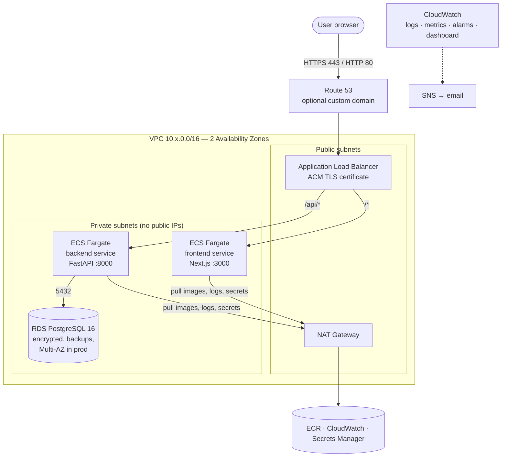
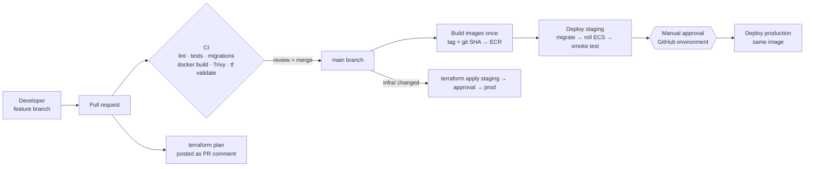

# Architecture

## Runtime (one environment)



## Delivery pipeline



## Security-group chain

```
Internet ──80/443──▶ alb-sg ──3000/8000──▶ app-sg ──5432──▶ db-sg
```

Only the load balancer is internet-facing. Tasks and the database live in
private subnets, and each layer only accepts traffic from the layer in front of it.

## Key decisions (and why)

| Decision | Why | Trade-off |
|---|---|---|
| ECS Fargate over EKS | No cluster/nodes to run or patch; right size for 2 services | Less portable than Kubernetes |
| ECS Fargate over EC2 + Docker | No servers, built-in rolling deploys, autoscaling, rollback | Slightly higher per-vCPU price |
| One ALB, path routing (`/api/*`) | Same origin → no CORS; one TLS cert; one entry point | Frontend and backend share one hostname |
| RDS over self-hosted Postgres | Backups, patching, Multi-AZ failover handled by AWS | Cost; less tuning control |
| Terraform with S3 native locking | Standard IaC; no DynamoDB table to manage (TF ≥ 1.10) | Needs a one-time bootstrap stack |
| GitHub OIDC instead of access keys | No long-lived secrets in GitHub; per-branch/environment trust | Slightly more IAM setup |
| Build once, promote the same image | What you tested in staging is exactly what runs in prod | Shared ECR across environments |
| Migrations as a one-off ECS task before rollout | Schema is ready before new code runs; a failed migration stops the deploy | Migrations must be backward compatible |
| Terraform ignores `task_definition` on services | CI/CD owns the version, Terraform owns the infrastructure; no tug-of-war | Image version isn't visible in Terraform state |
